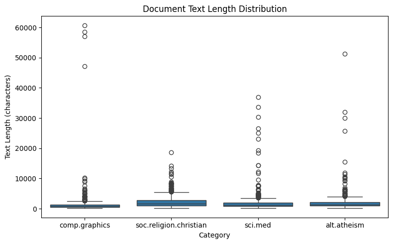
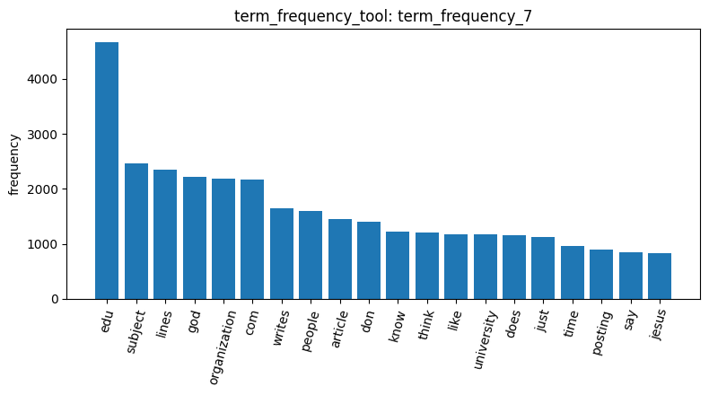
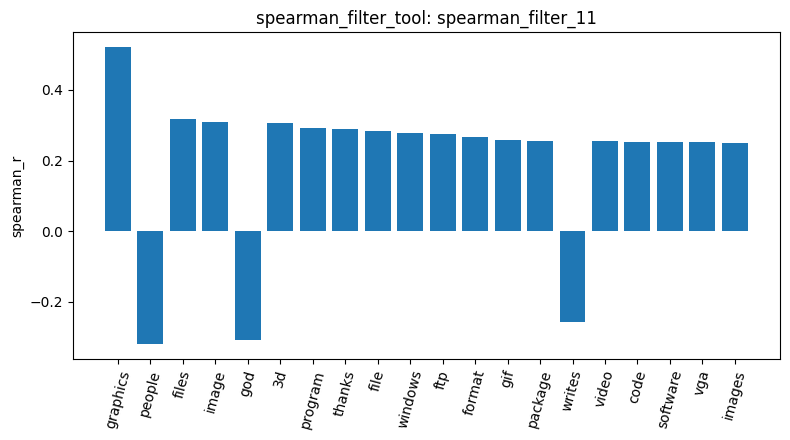
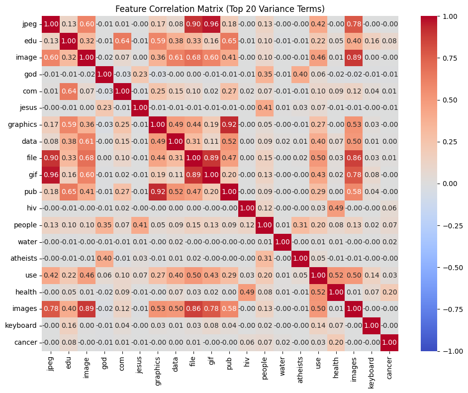
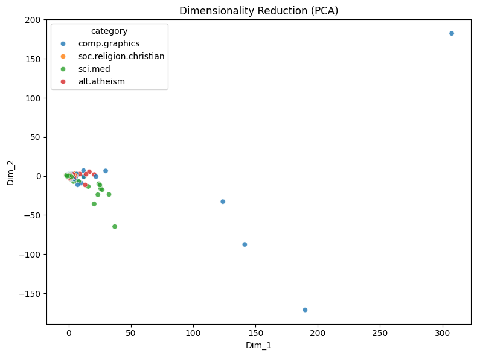
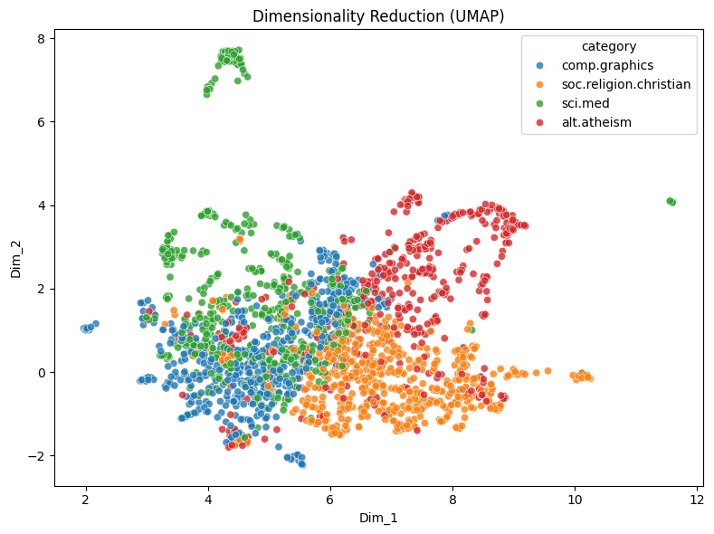

# Agentic Pipeline Report

Data loading and exploration. I loaded 2,257 posts from four categories using load_dataset_1: christian (599), med (594), graphics (584), and atheism (480), matching the Master dataset. The data quality checks found no missing values (check_missing_3) or duplicate posts (check_duplicates_4), so I skipped sampling to preserve the original category distribution. However, inspect_data_2 revealed that the raw posts still contained email headers such as From, Subject, Organization, and Lines, which could affect the subsequent analysis. The text lengths were right-skewed, with a mean of 1,993 characters and a median of 1,235. The describe_data_5 results and the saved text-length plot show that comp.graphics contained the longest posts, reaching 60,713 characters.

Word frequency and feature filtering. The document-term matrix created by build_dtm_6 contained 35,482 unique words and was 99.68% sparse (same as in Master notebook Q4). The term_frequency_7 results and saved top-terms plot showed that words such as “edu,” “subject,” “lines,” and “organization” appeared frequently alongside topic-related words such as “god” and “jesus.” I applied a variance filter with a threshold of 0.01, retaining 5,089 words (variance_filter_9), although this filter did not remove irrelevant header terms because it did not consider category labels. For comp.graphics, Pearson correlation prioritized words such as “thanks” and “hi” (pearson_filter_10), while Spearman correlation ranked more meanigful terms, including “graphics,” “image,” and “3d,” with “graphics” reaching a correlation of 0.52 (spearman_filter_11). This suggests that Spearman correlation was more useful for identifying topic-related words in this dataset.

Correlation, pattern mining, and dimensionality reduction. The feature-correlation heatmap (feature_correlation_12) showed a strong relationship between “jpeg” and “gif” (0.96), a weaker relationship between “god” and “jesus” (0.23), and near-zero correlations between words from different topics. However, pattern mining on sci.med (mine_patterns_13) mainly returned email-header terms, with “subject” having a support of 594, corresponding to every post in that category. PCA (reduce_dimensions_14) placed most posts in one dense cluster, with a few graphics outliers, and retained only 26.6% of the variance in the two-dimensional representation. In contrast, the saved UMAP plot (reduce_dimensions_15) separated the categories more clearly, although atheism and christian overlapped near their boundaries, and graphics and med showed some overlap. These results suggest that UMAP captured the structure of the dataset more effectively than PCA in this experiment.

Similarity analysis and conclusion. I binarized the category labels into four one-hot columns using binarize_labels_16, with graphics represented as [0, 1, 0, 0]. The cosine similarity results were 0.058 for two graphics posts (cosine_similarity_17) and 0.064 for a graphics post compared with a christian post (cosine_similarity_18). These low similarities suggest that the raw word-count representation did not reliably capture the shared topics between documents. Overall, email headers introduced noise into frequency analysis, feature selection, and pattern mining. Nevertheless, Spearman correlation and UMAP still revealed meaningful topic-related structure. For future improvements, I would remove email headers before preprocessing and use TF-IDF instead of raw word counts to reduce the influence of frequently occurring terms.