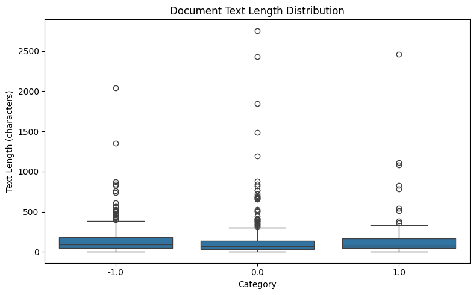
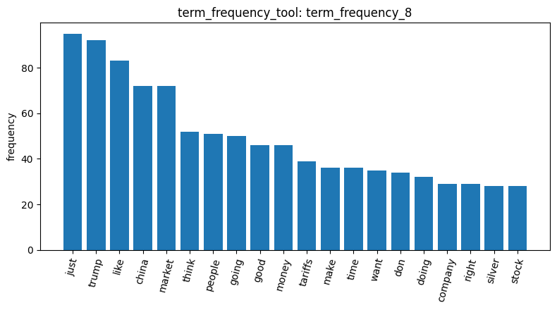
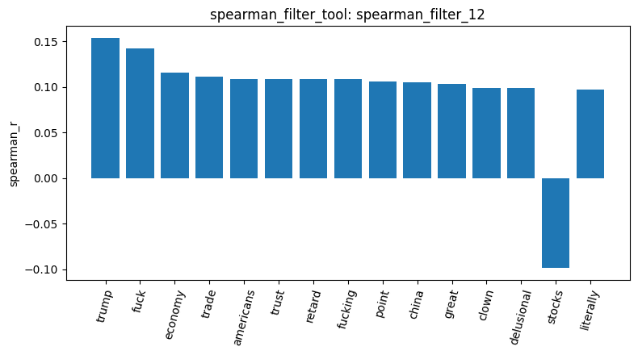
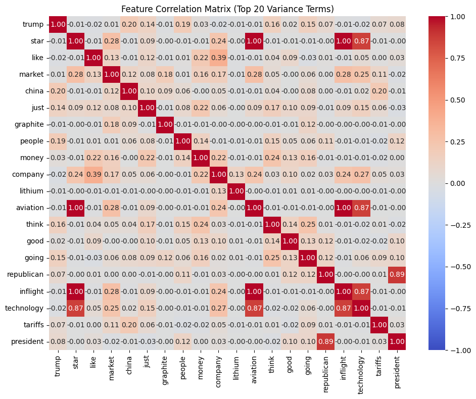
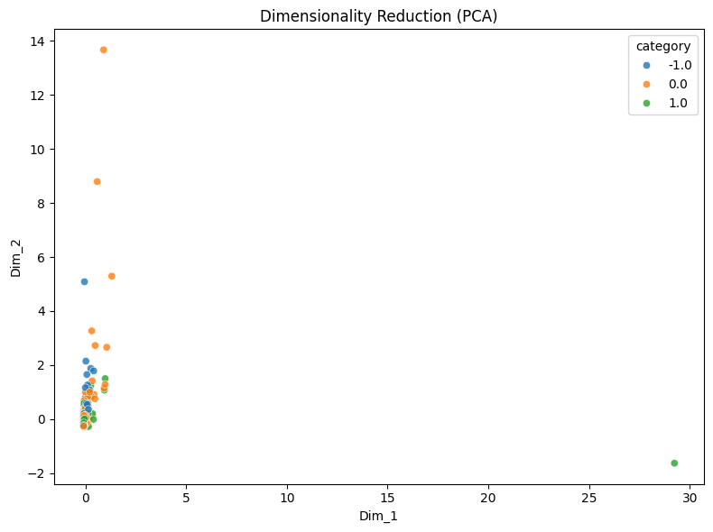
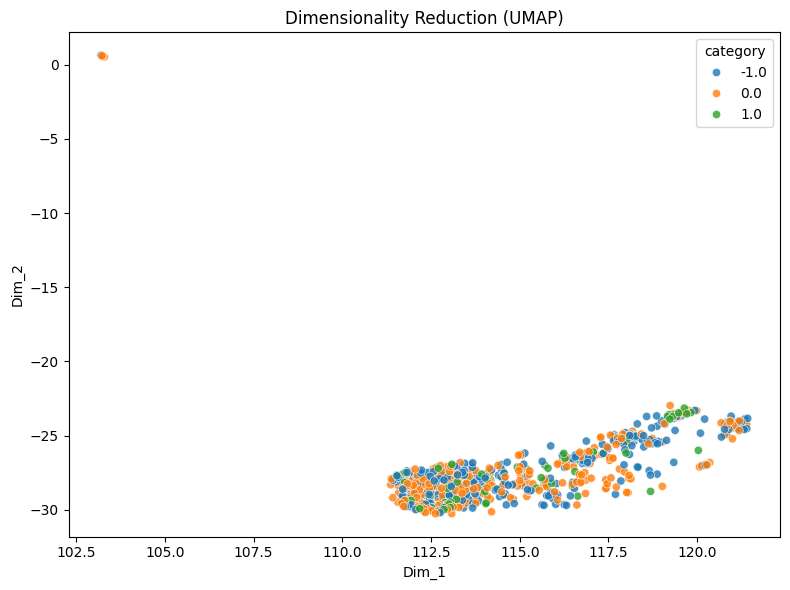

# Homework report

Data loading and exploration. I loaded 847 Reddit stock posts with three sentiment labels using `load_dataset_1`: neutral (423), negative (315), and positive (109). The dataset is imbalanced, with positive posts making up only about 13% of the total. In `inspect_data_2`, I noticed that some labels did not seem to match the meaning of the text. For example, “Seeing lots of red in the ticker” was labeled neutral, while “Calls on retards” was labeled negative. This suggests that the labels may come from a simple sentiment-scoring method that struggles with financial slang and context. The data quality checks found no missing values (`check_missing_3`), but `check_duplicates_4` identified 23 duplicates. Removing duplicated rows using `keep=False` removed 34 rows, leaving 813 posts (`check_duplicates_5`). Of the removed rows, 32 were neutral, suggesting that repeated content was more common in this category, although this does not necessarily mean the posts came from bots. The length analysis (`describe_data_6`) showed a median text length of only 80 characters, compared with 1,235 in the previous newsgroup dataset. Negative posts were slightly longer, with a median of 96 characters. I skipped sampling because the positive category was already small, and sampling could further reduce the available data.

Word frequency and feature filtering. The document-term matrix created by `build_dtm_7` contained 4,072 unique words and was 99.71% sparse, with approximately 11.7 words per post in the resulting representation. The `term_frequency_8` results showed that the most common words were “trump” (92 occurrences), “china” (72), “market” (72), and “tariffs” (39), suggesting that the dataset mainly discusses US–China tariff news and its potential effects on the stock market. Unlike the previous newsgroup dataset, email headers did not dominate the most frequent terms, although casual words such as “just” and “like” still added noise. The variance filter with a threshold of 0.01 retained only 340 words, around 8% of the original vocabulary (`variance_filter_10`). However, it also removed potentially useful sentiment words such as “stupid”. Terms such as “star” and “graphite” ranked highly, possibly because they appeared in promotional posts rather than reflecting general sentiment. The Pearson filter for positive sentiment identified 41 words, including “huge”, “nice”, and “potential”, alongside terms such as “technology” and “tldr” that may have come from promotional content (`pearson_filter_11`). Meanwhile, the Spearman filter for negative sentiment returned only 11 words, including “trump”, “economy”, “trade”, and “china” as well as swear words (`spearman_filter_12`). Its strongest correlation was only 0.15, much lower than the 0.52 observed for “graphics” in the previous project. The appearance of “great” among negative-associated words may indicate sarcasm or context that simple word-based methods cannot recognize.

Correlation, pattern mining, and dimensionality reduction. The feature-correlation heatmap (`feature_correlation_13`) showed that “star,” “aviation,” and “inflight” had a perfect correlation of 1.00, while “technology” correlated with them at 0.87. This suggests that these words appeared together in promotional content rather than representing a general positive-sentiment pattern. Political terms were less strongly associated, with “china” and “tariffs” showing a correlation of only 0.20. Pattern mining found that “trump” appeared in 45 of the 315 negative posts and “china” appeared in 33 (`mine_patterns_14`). For positive sentiment, “good” appeared in 12 posts, while “economy” appeared in both the positive and negative pattern lists (`mine_patterns_15`). This demonstrates that a word's sentiment depends on its context rather than simply its presence. PCA (`reduce_dimensions_16`) retained only 12.1% of the variance in two dimensions, and one positive promotional post appeared to dominate the first axis. In comparison, UMAP (`reduce_dimensions_17`) did not clearly separate the three sentiment categories, as their points remained mixed together. Unlike the previous newsgroup dataset, where documents could be separated by topic, Reddit posts expressing different sentiments often discuss similar subjects, making sentiment harder to distinguish using word frequencies alone.

Similarity analysis and conclusion. I converted the sentiment labels into three one-hot columns using `binarize_labels_18`. Although this representation separates negative, neutral, and positive sentiment, it loses their natural ordering of -1, 0, and 1, unlike the original sentiment scale. The cosine similarity between two short negative posts was 0.0 (`cosine_similarity_19`), meaning that the posts shared no terms in the vector representation used for the calculation. This highlights a limitation of bag-of-words methods: two posts can express similar feelings while using completely different words. Overall, the project showed that all 18 tools could be applied to a new dataset, but sentiment analysis was more difficult than topic identification in the previous project. Political discussions appeared frequently among negative posts, while some company-related or promotional content appeared among positive posts. However, the weak correlations, limited patterns, possible labeling errors, and lack of clear separation in UMAP suggest that individual words alone are insufficient for reliably identifying sentiment. To improve the results, I would use more accurate sentiment labels, remove promotional and bot-like posts where appropriate, and apply methods that better understand context, negation, financial slang, and sarcasm. TF-IDF or contextual language embeddings could also provide better text representations, although they would not fully solve the problem of inaccurate labels.